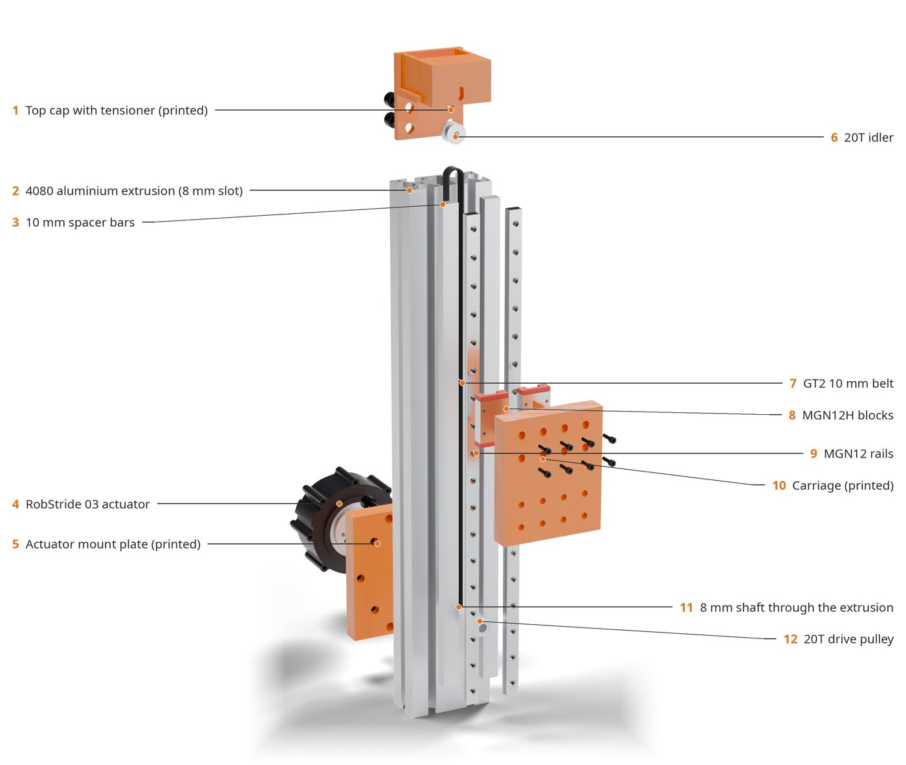
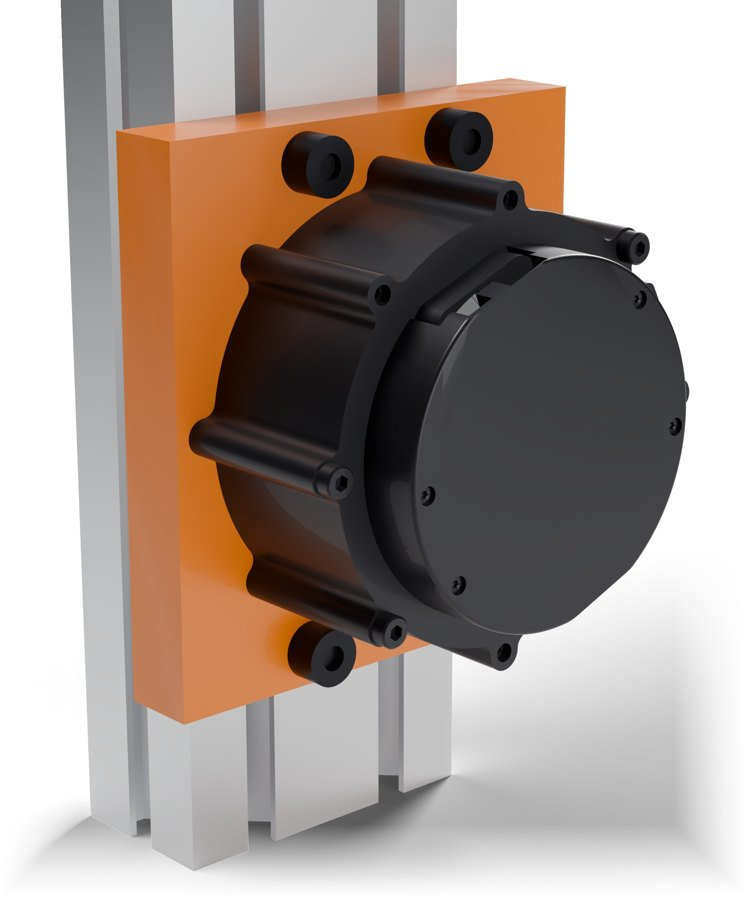

# agent-cad-works

**Agent-driven mechanical design that proves its parts fit and print, before you print them.**

You (or an AI agent) write a part as a [build123d](https://github.com/gumyr/build123d) Python file.
`agentcad` then:

- sweeps the mechanism through its motion for collisions
- checks every printed part is a single watertight solid with nothing printing in mid-air
- slices it with OrcaSlicer for real print times
- fits it against the manufacturer's own STEP model of each bought part
- writes the bill of materials
- produces a phone-friendly viewer, FreeCAD exploded views with callouts, and Blender photoreal renders

A Claude Code plugin packages the workflow, so an agent can take a request from *"I need a mount for X"* to a
checked, printable, documented design.

<p align="center">
  
  
</p>

The example above is a real design: a belt-driven vertical axis for a robot arm, driven by a RobStride 03,
in [`examples/zlift`](examples/zlift/). It went through six versions. Two of its checks caught problems that
looked fine on paper:
- the actuator drawing it was first designed from belonged to a different model
- the real actuator's pilot is 1 mm wider at its base than the drawing says

## Quick start

```bash
git clone <this repo> agent-cad-works && cd agent-cad-works
uv sync && uv run pytest -q                 # pinned environment, 16 tests
uv run agentcad new parts/bracket           # a design file from the template
uv run agentcad check parts/bracket         # the verification gates; exit code 1 on failure
uv run agentcad all parts/bracket           # + BOM, renders, exploded view, photoreal
uv run agentcad serve parts/bracket         # view it on your phone: http://<host>:8765/
```

`check` and `render` need nothing beyond the Python environment. Slicing, exploded views and photoreal
renders use OrcaSlicer, FreeCAD and Blender: see [docs/toolchain.md](docs/toolchain.md), then run
`agentcad doctor`.

With Claude Code:

```text
/plugin install agent-cad-works --marketplace <owner>/agent-cad-works
```

Then describe the part you need. See [docs/plugin.md](docs/plugin.md).

## What "verified" means here

| gate | how | catches |
|---|---|---|
| interference | exact OCCT booleans at every pose in `Design.states()`; parts, hardware, keep-out zones | collisions over the full travel, parts entering a no-go zone |
| printability | one valid closed solid; watertight + manifold mesh (trimesh, manifold3d); layer-by-layer island analysis; OrcaSlicer slice without warnings | split parts, non-manifold joints the kernel accepts, slivers printing in mid-air, parts that need supports |
| design checks | per design; vendor-STEP fit with a control that must fail; proof that the sweep can fail | wrong datasheet, hole patterns that do not line up, checks that cannot fail |

A design is done when `agentcad check` passes. Details: [docs/verification.md](docs/verification.md).

## Commands

| command | does |
|---|---|
| `agentcad new <dir>` | start a design from the template |
| `agentcad doctor [<design>]` | report which tools are found and what that enables |
| `agentcad check <design>` | all gates → `out/check.json`, print-oriented STL/STEP, G-code |
| `agentcad bom <design>` | `out/BOM.md` from the design (lengths computed, not typed) |
| `agentcad render <design>` | quick renders + viewer site `out/site/` |
| `agentcad explode <design>` | FreeCAD exploded and assembled documents, views with callouts |
| `agentcad photoreal <design>` | Blender Cycles renders, white and transparent, callouts, close-ups |
| `agentcad all <design>` | everything, in order; skips renders if checks fail |
| `agentcad serve <design>` | serve `out/site/` on the LAN |

## Documentation

- [Getting started](docs/getting-started.md): install, configure tools, first design
- [Design interface](docs/design-interface.md): how a design file is structured
- [Verification](docs/verification.md): the gates, vendor fit, reading failures
- [Rendering](docs/rendering.md): viewer, FreeCAD exploded views, Blender photoreal
- [Parts library](docs/parts-library.md): sourced bought parts, and adding new ones
- [Toolchain](docs/toolchain.md): pinned versions and installation
- [Claude Code plugin](docs/plugin.md): skills and the reviewer agent
- [Architecture](docs/architecture.md): modules, data flow, outputs
- [Lessons learned](docs/lessons-learned.md): the failures each rule comes from
- [Roadmap](docs/roadmap.md)

## Repository layout

```
src/agentcad/     the package and the `agentcad` CLI
plugin/           Claude Code plugin: design-part, vendor-fit, product-renders skills; cad-reviewer agent
examples/zlift/   worked example
docs/             documentation
tests/            pytest
vendor/           your vendor STEP files (git-ignored; not redistributable)
```

## Status

Version 0.1.0. Tested on Ubuntu 24.04 with:

| tool | version |
|---|---|
| Python | 3.12 |
| build123d | 0.13.0 (OCCT 8.0.1) |
| OrcaSlicer | 2.4.2 (Bambu X1C profiles) |
| FreeCAD | 1.1.1 (snap) |
| Blender | 4.5.15 LTS (OptiX on an RTX 5090) |

Licence: not chosen yet (see [roadmap](docs/roadmap.md)).
