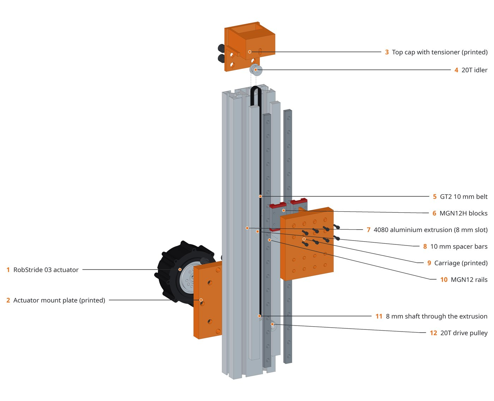

# Rendering

| command | engine | output | time (Z lift) |
|---|---|---|---|
| `agentcad render` | matplotlib | `out/site/` viewer: assembly, parts, details PNGs, three.js STL viewer | ~15 s |
| `agentcad explode` | FreeCAD 1.1 under Xvfb | FCStd documents (exploded + assembled), orthographic views, callouts | ~2 min |
| `agentcad photoreal` | Blender 4.5, Cycles | JPEG on white with soft shadows, transparent PNG, callouts, close-ups | ~3.5 min on an RTX 5090 (512 samples) |

 

All three read the same `Design.presentation()` (components, materials, explode offsets, labels) through
`agentcad.presentation.export`. That writes STEP/STL per component and a `manifest.json`, the only interface
to the scripts that run inside FreeCAD and Blender.

## Callouts

- FreeCAD: an **ID pass** renders each part in a flat emissive colour. A label's anchor must sit in a patch of
  its own colour, so dots only land on visible faces. The viewport-to-image mapping is **fitted** from the ID
  render, because `saveImage` does not keep the viewport's framing.
- Blender: anchors are mesh vertices that a **ray from the camera** reaches first.
- Labels sit in two columns, keep the vertical order of their anchors, and neighbours whose leader lines would
  cross are swapped. Parts not visible in a view are reported and left unlabelled.

## Tuning photoreal

- Quick look: `agentcad photoreal <design> --samples 64 --pct 40 --shots exploded_front`.
- Exposure: `LIGHT_W` and the world strength in `src/agentcad/data/blender_scene.py`. Black parts must look
  black.
- Materials: `materials()` in the same file. Printed parts get 0.2 mm layer lines along `ShowPart.print_axis`.
- Close-ups: add `Shot(..., frame_box=((x0,y0,z0),(x1,y1,z1)), hidden=(...))` in `Design.shots()`.
